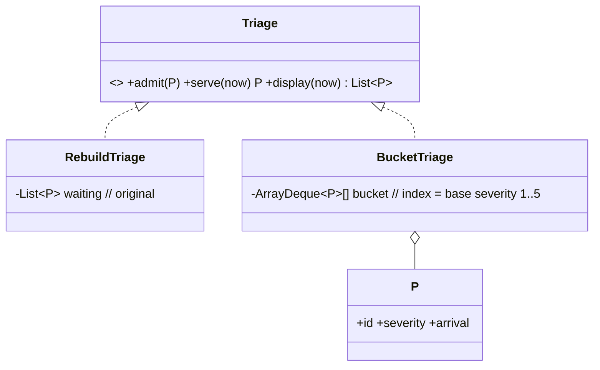

# Q7 – Day-4 Design Challenge: Diagnose, Redesign and Validate (K5)

**Solution selected: the *fair* (aging) emergency triage queue from Q6.** In Q6 the strict `PriorityQueue` was fast (≈ 0.14–0.2 µs per serve), but it starved a severity-5 patient for more than 12 hours. Fixing that with an aging rule changed the requirement, because priority now depends on *time*, and the original structure scaled badly under the new requirement.

## A. Diagnose the bottleneck

Evidence from my original implementation (`RebuildTriage`, the same code as Q6's aging simulation), measured on identical workloads:

| Waiting n | Time per serve | Bytes allocated per serve |
|---|---|---|
| 100 | 1.87 µs | 608 |
| 1,000 | 6.69 µs | 4,176 |
| 10,000 | 71.19 µs | 40,176 |
| 100,000 | **842.28 µs** | **400,176** |

* **Where the time and memory go:** in `serve()`, all n waiting patients are copied into a brand-new `PriorityQueue` built with a comparator for the current time (`addAll`, O(n log n)). After one `poll()`, the whole heap is thrown away. `waiting.remove(next)` then searches and shifts the list (O(n)). Allocation is about 4 bytes × n per serve, i.e. a fresh n-element heap array every time.
* **Which operation grows:** serve time grows ×10 per ×10 n (6.7 → 71 → 842 µs). That is linear or worse, against the O(log n) the Q6 queue had without aging.
* **Repeated work:** yes. Every serve re-sorts (heapifies) patients whose *relative* order mostly did not change since the last serve. Only the passage of one minute changed, and that rarely reorders anyone.
* **Characteristic of the class that causes it:** a `PriorityQueue` assumes **keys are fixed after insertion**. The heap invariant is checked only on `add`/`poll`. With aging, every waiting patient's key changes continuously. Keeping the old heap would silently violate the invariant and serve the wrong patient, so the original design *had* to rebuild, and rebuilding is what makes it O(n log n) per serve.

## B. Design objective

The redesign must:

1. **Serve in O(1) (independent of n)**, with a measurable target of **< 1 µs per serve at 100,000 waiting patients** (the original takes 842 µs).
2. **Avoid scanning or re-sorting the whole waiting list** on a serve: at most a constant number of comparisons per serve.
3. **Allocate O(1) bytes per serve**, not O(n) (the original allocates 400 KB per serve at n = 100k).
4. **Preserve correctness exactly:** the same treatment order as the original for the same arrivals, the same anti-starvation result (the S5 patient seen at t = 110 min in the Q6 scenario), and a waiting-list display in the current treatment order without re-sorting.

## C. The revised solution

**Key observation (the property I exploit).** The aging rule is *effective = max(1, severity − ⌊wait / 30⌋)*. Take two patients with the **same base severity**. The one who arrived earlier has waited longer, so their effective level is ≤ the other's, and on a tie they win on arrival time. Within one base-severity group, **arrival order is always the current treatment order**, no matter how much time has passed. That order never has to be recomputed. It only has to be *kept*, and a FIFO queue keeps arrival order for free.

**Revised structure:** five FIFO queues, one per *base* severity (`ArrayDeque<P>[6]`).



```
ALGORITHM Admit(p)
1. APPEND p TO END OF bucket[p.severity]            // arrivals are increasing → bucket stays in arrival order

ALGORITHM Serve(now)
1. best ← NONE
2. FOR s ← 1 TO 5 DO                                // 5 comparisons, independent of n
3.     IF bucket[s] NOT EMPTY THEN
4.         h ← HEAD(bucket[s])
5.         IF best = NONE OR (Effective(h, now), h.arrival) < (Effective(HEAD(bucket[best]), now), HEAD(bucket[best]).arrival)
6.             THEN best ← s END IF
7.     END IF
8. END FOR
9. IF best = NONE THEN RETURN NULL END IF
10. RETURN REMOVE HEAD OF bucket[best]

ALGORITHM Display(now)                              // waiting list in current treatment order
1. 5-way merge of the five buckets using the same comparison as Serve   // each bucket is already sorted
```

**Why `Serve` is correct.** Each bucket's head dominates every other member of that bucket (key observation). So the global best patient must be one of the ≤ 5 heads, and comparing the heads with the *same* comparator as the original gives the same choice.

| Aspect | Change |
|---|---|
| What changed | The single list + rebuilt heap is replaced by 5 arrival-ordered FIFO buckets keyed by *base* severity |
| Property exploited | Aging is monotone in waiting time, so FIFO order within a base severity = treatment order at every instant; the severity domain is small (5) |
| Operations avoided | No heap construction, no O(n log n) re-sort, no O(n) `remove(Object)`; serve does ≤ 5 comparisons, and display is a merge instead of a sort |
| Extra memory / preprocessing | None. 5 `ArrayDeque`s hold the same n references (amortised ≤ 2× capacity, like `ArrayList`); no preprocessing |
| New trade-offs | The design depends on the aging function being monotone and on the priority domain being small. A rule such as "children first after 22:00" that is *not* monotone in arrival would break the key observation. With k levels, serve is O(k). |

## D. Prediction (made before implementing)

* Serve time should become **constant**, about 0.1 µs, at every n. So the improvement should grow roughly linearly with n: about 10× at n = 100 and several thousand × at n = 100,000.
* Allocation per serve should become constant, a few hundred bytes (the comparator for `now`), independent of n.
* The treatment order and the starvation result should be **identical** to the original.

## E. Implementation and validation (`AgingTriageRedesign.java`, same workloads)

**Correctness** (real output):

```
Correctness n=50: 600 serves, identical treatment order? true
Correctness n=2000: 600 serves, identical treatment order? true
Display (waiting list in current treatment order) identical? true
Q6 starvation scenario with redesign: S5 patient seen at t = 110 min (Q6 aging result: 110)
```

**Performance:**

* Workload: n patients already waiting (arrived over the previous 3 h), then repeated cycles of "1 minute passes, 1 patient arrives, 1 patient is served". The same random seed is used for both designs.
* Each figure is the mean of 3 timed runs after a warm-up run.
* Bytes are measured with `ThreadMXBean.getCurrentThreadAllocatedBytes()`.

| Waiting n | Serves timed | Original (µs/serve) | Redesign (µs/serve) | Speed-up | Original bytes/serve | Redesign bytes/serve |
|---|---|---|---|---|---|---|
| 100 | 2,000 | 1.87 | 0.141 | 13× | 608 | 152 |
| 1,000 | 2,000 | 6.69 | 0.098 | 68× | 4,176 | 152 |
| 10,000 | 235 | 71.19 | 0.085 | 842× | 40,176 | 168 |
| 100,000 | 50 | 842.28 | **0.117** | **7,220×** | 400,176 | **152** |

(Fewer serves were timed for the original at large n, only because it is so slow. Per-serve figures are comparable.)

## F. Defence of the final design

* **Was the prediction supported?** Yes. Redesign serve time is flat at 0.09–0.14 µs from n = 100 to 100,000, i.e. O(1). The speed-up grows almost exactly with n (13× → 68× → 842× → 7,220×). Allocation per serve is constant at about 152 B, against the original's 4 B × n. Order, display and starvation behaviour are identical.
* **Magnitude:** at the objective's operating point (100,000 waiting), 842 µs → 0.117 µs. The < 1 µs target is met with almost a 10× margin.
* **New costs and trade-offs:**
  * Correctness now rests on a *mathematical property* of the aging rule (monotone in waiting time within a base severity). That assumption must be documented and re-checked whenever the triage policy changes.
  * The structure supports only a small, fixed set of base levels; a continuous risk score would need a different design.
  * The display is a 5-way merge: O(5n), not O(1). It is still cheaper than the original's O(n log n) sort.
* **When the original might still be preferable:**
  * When the priority rule is *arbitrary* (e.g. depends on the doctor on duty, or on a non-monotone score), only "re-evaluate everyone" is correct.
  * When the waiting list is tiny (for a single-doctor clinic with 10 patients, 1.9 µs vs 0.14 µs is irrelevant, and the rebuild code is simpler to verify).
  * The strict Q6 `PriorityQueue` *without* aging is also fine where starvation cannot occur (e.g. a scheduled appointment list).

**Conclusion:** the redesign meets every stated objective with measured evidence. It does this not by "using a faster collection", but by recognising that, for this aging rule, arrival order within a base severity already *is* the treatment order. The repeated sorting the original did was therefore unnecessary work, and the redesign removes it.
