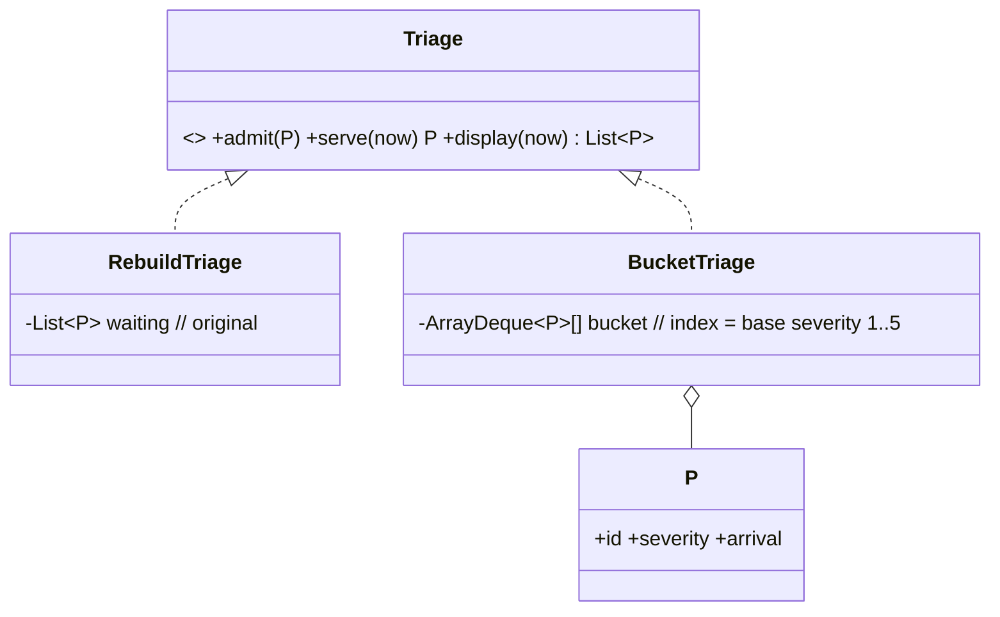

# CSA09 – Programming in Java – Assignment 2 Report

## Cover Page

| | |
|---|---|
| **GitHub Repository Link** | https://github.com/Nithish250707/CSA09-192511478-Assignment2 |
| Name | Nithish G |
| Register Number | 192511478 |
| Programme | B.E. Computer Science and Engineering, SIMATS Engineering, Chennai |
| Course | Programming in Java (CSA0921; printed as CSA09 in the assignment) |
| Assignment | 2 – CO2: Strings, Collections, hashCode–equals, Generics and Comparators |

---

## Contents

- [Q1 – Building Text Under Load: String, StringBuilder or StringBuffer? (K4)](#q1--building-text-under-load-string-stringbuilder-or-stringbuffer-k4)
- [Q2 – When Is ArrayList an Appropriate Engineering Choice? (K4)](#q2--when-is-arraylist-an-appropriate-engineering-choice-k4)
- [Q3 – Engineer the hashCode–equals Contract (K4)](#q3--engineer-the-hashcodeequals-contract-k4)
- [Q4 – Choosing a Map for a Pharmacy Inventory (K4)](#q4--choosing-a-map-for-a-pharmacy-inventory-k4)
- [Q5 – Derive a Generic Ranking Component from a Principle (K4)](#q5--derive-a-generic-ranking-component-from-a-principle-k4)
- [Q6 – Priority, Order and Fairness in a Queue (K5)](#q6--priority-order-and-fairness-in-a-queue-k5)
- [Q7 – Day-4 Design Challenge: Diagnose, Redesign and Validate (K5)](#q7--day-4-design-challenge-diagnose-redesign-and-validate-k5)

All program outputs quoted below are copied from the `output.txt` file in each task folder, produced by actually running the code (see README for commands).

---

<!-- folder: Q1 -->
## Q1 – Building Text Under Load: String, StringBuilder or StringBuffer? (K4)

### Prediction (made before running)

* **`String` with `+` in a loop.** A `String` is immutable, so `s = s + field + "|"` cannot change `s`. Each iteration allocates a **new** String and copies every character built so far. For a ticket of n fields of average length L, the copies are L + 2L + … + nL = O(n²·L) characters, and n intermediate Strings become garbage at once. Prediction: negligible for a short ticket, noticeably slower for 50 fields, and **dramatically** slower (quadratic) for thousands of fields.
* **`StringBuilder`** keeps one resizable `byte[]`. `append` copies only the new characters, and the array doubles when full (amortised O(1) per character), so total work is O(n·L) and there is 1 final String per ticket. Prediction: linear, and the fastest.
* **`StringBuffer`** is the same algorithm, but every method is `synchronized`. With one thread the lock is uncontended and the JIT can elide or bias it. Prediction: within about 10–30 % of `StringBuilder`.
* `String.join`/`StringJoiner` use a builder internally, so they should be close to `StringBuilder`. `String.format` parses the format string on every call, so it should be several times slower.

### Workloads designed

| Workload | Shape | Why it was chosen |
|---|---|---|
| W1 | 1 ticket × 8 fields | The everyday single booking, where "does it matter?" is tested at its most favourable for `+` |
| W2 | 10,000 tickets × 50 fields | A full day of e-tickets: many medium strings (the PDF's contrasting load) |
| W3 *(own)* | 20 tickets × 5,000 fields | A group/charter manifest (whole-train booking). One very long ticket exposes the O(n²) growth inside a single ticket |

### Measured results (`TicketBuilderBenchmark.java`, real numbers in `output.txt`)

Time is the mean of 5 timed runs after 1 warm-up (W1: 2,000 runs). *Alloc* is the increase in used heap measured with `Runtime` before and after the timed loop (after `System.gc()`). It is approximate: heap grows in TLAB-sized chunks, and 0.04 MB is the measurement floor.

| Approach | W1 time (ms) | W2 time (ms) | W2 alloc (MB) | W3 time (ms) | W3 alloc (MB) | Intermediate Strings, W2 / W3 (estimate) |
|---|---|---|---|---|---|---|
| `String +` in loop | 0.0031 | 7.63 | 43.4 | **110.40** | **124.6** | 500,000 / 100,000 |
| `StringBuilder` | 0.0021 | 2.12 | 17.5 | **0.34** | 3.9 | 10,000 / 20 |
| `StringBuffer` | 0.0021 | 2.15 | 18.0 | 0.35 | 3.9 | 10,000 / 20 |
| `String.join` | 0.0027 | 2.69 | 13.0 | 0.55 | 2.4 | 10,000 / 20 |
| `StringJoiner` | 0.0028 | 2.40 | 11.0 | 0.47 | 2.3 | 10,000 / 20 |
| `String.format` | 0.0058 | 21.67 | 25.3 | 3.95 | 11.6 | 500,000 / 100,000 |

The intermediate-String count is an estimate. `s = s + x + "|"` is compiled (JDK 9+) as one `invokedynamic` concatenation, so it produces 1 new String per field, each a full copy of the text so far. Builders produce 1 String per ticket. `format` produces 1 String per field.

### Prediction vs observation

| Prediction | Observed | Verdict |
|---|---|---|
| `+` negligible for a short ticket | W1: 3.1 µs vs 2.1 µs, i.e. 1 µs per ticket | **Confirmed.** At 8 fields, `+` is fine |
| `+` clearly slower at 50 fields | W2: 3.6× slower and 2.5× the allocation | **Confirmed** |
| `+` quadratic for long text | W3: **328× slower** (110 ms vs 0.34 ms) and **32× the allocation**. 100× more fields per ticket than W2 made `+` ~14× slower *per ticket*, while `StringBuilder` time per field stayed flat | **Confirmed**: the cost depends on the square of the length |
| `StringBuffer` 10–30 % slower | 0–4 % slower single-threaded | **Partly wrong.** Uncontended locks are almost free on JDK 21, so the predicted penalty did not appear |
| `format` several times slower | 10× slower than the builder in W2 and 12× in W3 | **Confirmed** |

### Design decision – multithreaded booking server

Shared-log experiment (real output): 4 threads each append 50,000 lines to one shared object.

| Trial | Expected length | `StringBuilder` | `StringBuffer` |
|---|---|---|---|
| 1 | 4,800,000 | 4,749,624 – **CORRUPTED** (lines lost) | 4,800,000 – OK |
| 2 | 4,800,000 | 4,756,392 – **CORRUPTED** | 4,800,000 – OK |
| 3 | 4,800,000 | 4,753,392 – **CORRUPTED** | 4,800,000 – OK |

* **Per-ticket text → `StringBuilder`.** Each ticket is built by one request thread in a local variable, so the object never escapes its thread and needs no lock. It was the fastest in every workload.
* **Shared booking log → not a bare `StringBuilder`.** Concurrent `append`s race on the internal `count` and array, and about 1 % of the characters were lost in every trial. `StringBuffer` was correct in all 3 trials because each `append` holds the object's lock. It is my recommendation where a shared in-memory text buffer is truly needed. Note that `StringBuffer` makes each *call* atomic, not a *sequence* of calls: `log.append(pnr).append(status)` from two threads can interleave between the two calls. Build each full line in a local `StringBuilder` and append it to the shared log in **one** call.
* At server scale, a better design is a `ConcurrentLinkedQueue<String>` or a logging framework writing to a file. Threads then do not contend on one growing buffer.

### Alternative Concept and Complexity Analysis

**Solutions with the alternatives:**

```java
String ticket = String.join("|", fields) + "|";                 // join
StringJoiner j = new StringJoiner("|", "", "|"); for (String f : fields) j.add(f);  // joiner
for (String f : fields) sb.append(String.format("%s|", f));     // format
```

**Derivation.** Let a ticket have n fields of average length L, so the final length is N = nL.

* Repeated `+`: iteration i copies the existing (i−1)L characters plus L new ones into a fresh String. Total copied = L(1 + 2 + … + n) = L·n(n+1)/2 = **O(n²L)**. It also creates n intermediate Strings of sizes L, 2L, …, nL, i.e. O(n²L) bytes of garbage, even though only O(nL) are live at any time.
* `StringBuilder`: each character is copied once on `append`, plus array regrowth. Capacity doubles, so regrowth copies at most N + N/2 + N/4 + … < 2N characters. Total **O(nL) = O(N)**. Garbage: O(log N) discarded arrays + the 1 final String.
* `String.join` / `StringJoiner`: also **O(N)**. Since JDK 17 `String.join` pre-computes the exact size and copies once, so it does no regrowth. `StringJoiner` is similar. Both keep the n input Strings alive in an array: O(n) references.
* `String.format`: O(N) characters in total, but each call parses the pattern and creates a `Formatter` and a String, so the constant factor is much larger. It also creates n intermediate Strings, like `+` but without the quadratic copying.

| Approach | Time to build n fields | Extra space (intermediate objects) | Measured W3 |
|---|---|---|---|
| `+` in loop | O(n²L) | O(n²L) garbage, n Strings | 110.4 ms, 124.6 MB |
| `StringBuilder` / `StringBuffer` | O(nL) | O(nL) + O(log N) regrown arrays | 0.34 ms, 3.9 MB |
| `String.join` | O(nL) | O(nL) – sized exactly | 0.55 ms, 2.4 MB |
| `StringJoiner` | O(nL) | O(nL) + array of n parts | 0.47 ms, 2.3 MB |
| `String.format` per field | O(nL), large constant | n Strings + n Formatters | 3.95 ms, 11.6 MB |

**Recommendation:**

* Use `StringBuilder` (or `String.join` when the fields are already in an array) for each ticket.
* Use `StringBuffer` only where one text buffer is genuinely shared between threads, and append whole lines.
* Never use `+` inside a loop.
* Reserve `String.format` for one-off formatting of a single field, such as the fare `"%.2f"`.

*Source code and raw output: [`Q1/`](https://github.com/Nithish250707/CSA09-192511478-Assignment2/tree/main/Q1)*

---

<!-- folder: Q2 -->
## Q2 – When Is ArrayList an Appropriate Engineering Choice? (K4)

### Experiment design

`PlaylistBenchmark.java` builds a playlist of `Song` records at three sizes (1,000, 10,000, 100,000) and times each operation separately, so one cost does not hide another.

| Operation | How it is exercised |
|---|---|
| add at end | k × `add(song)` |
| insert at front / remove at front | k × `add(0, song)` / `remove(0)` |
| insert / remove in the middle | k × `add(size/2, song)` / `remove(size/2)` |
| get k-th | k × `get(random index)` – "jump to the k-th song" |
| iterate | 20 full passes with for-each (the iterator) |

* k = min(1,000, n/2) operations per measurement.
* Each measurement is repeated 5 times on a freshly filled list; the first repetition is discarded as JIT warm-up and the mean of the other 4 is reported.
* The 1,000-element rows run first, so they still contain some warm-up noise (for example `get` at 120 ns).

### Results (ns per operation, `output.txt`)

| Operation | n | ArrayList | LinkedList | LinkedList ÷ ArrayList |
|---|---|---|---|---|
| add at end | 1k / 10k / 100k | 36.8 / 26.3 / 27.5 | 32.5 / 25.1 / 28.4 | ≈ 1 (same) |
| insert at front | 1k / 10k / 100k | 113.6 / 559.8 / **6,958.9** | 75.6 / 34.1 / **28.5** | ArrayList 244× slower at 100k |
| remove at front | 1k / 10k / 100k | 71.8 / 482.4 / **6,886.2** | 44.8 / 21.0 / **15.1** | ArrayList 456× slower at 100k |
| insert in middle | 1k / 10k / 100k | 81.2 / 297.0 / **3,547.4** | 1,096.1 / 8,860.0 / **84,773.5** | LinkedList 24× slower |
| remove from middle | 1k / 10k / 100k | 53.4 / 244.4 / 3,447.8 | 579.7 / 7,642.7 / 81,372.9 | LinkedList 24× slower |
| get k-th (random) | 1k / 10k / 100k | 120.0 / 47.8 / **48.9** | 466.3 / 4,229.1 / **43,420.4** | LinkedList **888×** slower |
| iterate (per element) | 1k / 10k / 100k | 19.2 / 3.4 / 2.1 | 8.4 / 2.8 / 2.6 | ≈ 1 |

What the numbers show:

* **ArrayList front operations** grow ×10 with n (560 → 6,959 ns), which is O(n): every insertion or removal at index 0 shifts all elements with `System.arraycopy`.
* **LinkedList middle operations** also grow linearly, and *faster* than ArrayList's, even though linking a node is O(1). The O(n/2) *walk to the middle* chases pointers across the heap (cache misses). ArrayList's shift is one bulk memory copy that the CPU streams very fast.
* **`get(k)`** is flat at about 48 ns for ArrayList, which is O(1) index arithmetic; the 48 ns mostly comes from `Random`. LinkedList walks from the nearer end, so its cost is O(n): 466 → 4,229 → 43,420 ns.
* **Iteration** is similar for both, because the nodes were allocated consecutively in this test. In a real long-lived app, nodes scattered by GC would make LinkedList iteration slower. A node is also 24 B (header + item + next + prev) against a 4 B array slot.

### Operating boundary – when is ArrayList reasonable?

**ArrayList is a reasonable choice** when the playlist workload is dominated by:

* appending songs,
* jumping to the k-th song,
* playing straight through,
* occasionally inserting or removing in the middle of lists of up to a few thousand songs.

That is exactly the normal "playlist" pattern. Even at 10,000 songs, a middle insertion costs 0.3 µs, which no user can notice, and the list uses about 6× less memory per song than LinkedList.

**I would stop recommending it** when operations at the *front* become frequent on large lists. At 100,000 songs each `add(0)` or `remove(0)` costs about 7 µs. A queue that does a million of them per session costs seconds, as the Up Next experiment below shows (4.6 s). The rule of thumb from my data: once front insertions/removals are a regular operation and n exceeds about 10,000, ArrayList is the wrong structure. LinkedList is rarely the answer either, because of its O(n) `get(k)` and slow middle access.

### Changed condition – the "Up Next" queue

Workload: start with 10,000 songs, then 1,000,000 random operations (40 % `addLast`, 20 % `addFirst`, 40 % `pollFirst`). Mean of 3 timed runs.

| Structure | Time |
|---|---|
| ArrayList (`add(0)`, `remove(0)`) | **4,616 ms** |
| LinkedList (`addFirst`, `addLast`, `pollFirst`) | 21.1 ms |
| **ArrayDeque** | **10.3 ms** |

**Re-evaluation:** the original recommendation (ArrayList) is **wrong for Up Next**: it is 450× slower than ArrayDeque. ArrayDeque is a circular array: the head and tail indices move, and no elements are shifted, so both ends are amortised O(1). It is also 2× faster than LinkedList because it allocates no node per song and has better cache locality. The app should therefore use **two structures**: `ArrayList<Song>` for the editable playlist (random access, position edits) and `ArrayDeque<Song>` for the Up Next queue (both ends, no indexing needed).

### Alternative Concept and Complexity Analysis

| Operation | ArrayList | LinkedList | ArrayDeque | Plain array + manual shift |
|---|---|---|---|---|
| add at end | O(1) amortised | O(1) | O(1) amortised | O(1) if spare capacity, else O(n) copy to a bigger array |
| insert at front | O(n) shift | O(1) | O(1) amortised | O(n) shift |
| insert in middle | O(n) shift (bulk copy) | O(n) walk + O(1) link | not supported (no index) | O(n) shift |
| get k-th | **O(1)** | O(n) walk (≤ n/2) | not supported (only ends) | **O(1)** |
| iterate | O(n) | O(n) | O(n) | O(n) |
| space per element | 1 reference (4 B) + up to 50 % spare capacity | node of ~24 B (header, item, next, prev) | 1 reference, power-of-two capacity | 1 reference, fixed capacity |

**Plain array with manual shifting:**

```
ALGORITHM InsertAtFront(arr, size, song)
1. IF size = length(arr) THEN arr ← copy of arr with double capacity END IF
2. FOR j ← size DOWNTO 1 DO  arr[j] ← arr[j-1]  END FOR
3. arr[0] ← song
4. size ← size + 1
```

Its Big-O is identical to ArrayList: O(n) front/middle insertion and O(1) `get`. The measured cost was 4.3 µs → 9.9 µs → **105.8 µs** per front insertion. That is **15× slower than ArrayList** at 100,000 songs (6.96 µs), because the element-by-element Java loop cannot match `System.arraycopy`'s bulk copy. The programmer also has to manage capacity, size and bounds by hand. ArrayList is exactly this design done correctly, so there is no reason to write it manually.

*Source code and raw output: [`Q2/`](https://github.com/Nithish250707/CSA09-192511478-Assignment2/tree/main/Q2)*

---

<!-- folder: Q3 -->
## Q3 – Engineer the hashCode–equals Contract (K4)

> Note: the PDF shows `if (this = = o)`. That is a spacing artifact of the PDF text and does not compile, so it was copied as `this == o`. Nothing else in the given code was changed.

### Complete the Code – before and after TODO 1

`before/Attendance.java` is the given code with TODO 1 left empty. `Attendance.java` is the same file with only this line added:

```java
@Override public int hashCode() { return regNo.hashCode(); }
```

| Run | Output |
|---|---|
| Before TODO 1 | `Unique students: 3` |
| After TODO 1 | `Unique students: 2` (**matches the expected output**) |

**Why they differ.** Before the fix, `Student` inherits `Object.hashCode()`, which is based on object identity, so the two `new Student("192311001", "Arun")` objects get different hash codes. `HashSet.add` uses the hash code to choose a bucket. The second Arun goes into a *different* bucket, where there is nothing to compare against, so `equals()` is **never called** and the duplicate is stored. After the fix, equal `regNo` gives an equal hash code and the same bucket; `equals()` then reports the duplicate and `add` returns `false`.

### Three designed tests – predictions recorded before execution

Each prediction was written into `ContractExperiments.java` *before* the first run, and the program prints prediction vs actual.

| Test | Design | Predicted size | Reason for the prediction | Actual |
|---|---|---|---|---|
| **T1** – appears to work | Broken class. The gate software re-uses the **same object** for a repeated tap (`add(arun)` twice) | 2 | Same reference → same identity hash → same bucket, and `==` matches | **2** ✔ |
| **T2** – exposes duplicates | Broken class. 6 scans of 3 students, each scan creates a **new** object (what a real card reader does) | 6 | Every object has its own identity hash, so all 6 land in different buckets | **6** ✔ |
| T2′ – same scans, fixed class | `FixedStudent` with `hashCode = regNo.hashCode()` | 3 | Equal keys → same bucket → `equals` detects them | **3** ✔ |
| **T3a** – own test: mutate key after insertion | `MutableStudent` (correct `hashCode`, but `regNo` not final). Add it, then change `regNo` to 192311099, then add a new object with 192311099 | 1 | I expected the set to "notice" the same student | **2** ✘ |
| **T3b** – own test: `TreeSet` with comparator inconsistent with `equals` | `TreeSet` ordered by **name**; two different students both named Priya, plus Rahul | 3 | Three different register numbers | **2** ✘ |

T1 shows why the bug survives casual testing: when the same object is re-added, everything looks correct. T2 is what happens in production, where every scan builds a new object. The output also shows the contradiction directly: `equals` is `true` but the hash codes are `804564176` vs `1421795058`, and `contains(new BrokenStudent("192311001"))` is `false`.

### Inquiry – comparing prediction and result

**Why duplicates appear (T2).** The contract says: *if `a.equals(b)` then `a.hashCode() == b.hashCode()`*. The broken class violates it. `HashSet` trusts the hash code to decide *where to look*, so a broken hash code means `equals` is never even consulted.

**How `HashSet` locates an element** (it is a `HashMap` with dummy values):

1. Compute `h = key.hashCode()`, then spread it: `h ^ (h >>> 16)`.
2. Bucket index = `h & (table.length − 1)`.
3. Walk that bucket's chain (or tree, if more than 8 entries collide). For each entry, first compare the stored hash. Only if the hashes are equal is `key == e.key || key.equals(e.key)` called.
4. If a match is found, `add` returns `false`; otherwise a new node is appended.

So `hashCode()` selects the bucket and `equals()` confirms identity *within* the bucket. Both must agree.

**Changing a field used in `hashCode()` after insertion (T3a – my prediction was wrong).**

* The object stays in the bucket computed from its **old** hash. Hash sets never re-hash existing entries.
* `contains(m)` now hashes the **new** regNo and looks in a different bucket, so it returns `false`.
* Adding the "same" student again therefore succeeds, and the size becomes 2.
* `remove(m)` returned `true`, but it removed the *second* object (which lives in the new bucket and is `equal` to m). The original entry is still in the old bucket, and no lookup can ever reach it. It is effectively a memory leak and a phantom attendee in any iteration.

I predicted 1 because I had reasoned only about `equals`. The result showed that the *location* is fixed at insertion time.

**TreeSet inconsistent with equals (T3b – my prediction was wrong).** `TreeSet` never calls `equals` or `hashCode`. It treats `compare(a, b) == 0` as "same element". Comparing by name makes two different students called Priya the same element, so the second is **silently dropped**: an absent record for a student who was present. The comparator for a de-duplication set must compare the identity key (`regNo`).

### The corrected Student class and how it is verified

```java
final class Student {
    private final String regNo;          // final: the key cannot change after insertion
    private final String name;
    Student(String regNo, String name) { this.regNo = Objects.requireNonNull(regNo); this.name = name; }
    @Override public boolean equals(Object o) {
        if (this == o) return true;
        if (!(o instanceof Student)) return false;
        return regNo.equals(((Student) o).regNo);
    }
    @Override public int hashCode() { return regNo.hashCode(); }   // same field as equals
    @Override public String toString() { return regNo + " " + name; }
}
```

* `hashCode` uses exactly the fields `equals` uses (only `regNo`; `name` is deliberately excluded, so a spelling difference at another gate does not create a new student).
* The key fields are `private final`, which prevents the T3a failure.
* The class is `final`, so a subclass cannot break symmetry.

**Verification** (real output): 10,000 random scans of 1,000 students → `HashSet size 1000, distinct regNos 1000 OK`. The distinct count was computed independently with a `HashMap<String, Integer>` tally. T2′ also gives 3 for 3 students.

### Alternative Concept and Complexity Analysis – `TreeSet` with comparator, or `HashMap<String, Student>`

```java
Set<Student> present = new TreeSet<>(Comparator.comparing(Student::regNo));   // no hashCode needed
Map<String, Student> present = new HashMap<>();                                // key = regNo
present.putIfAbsent(scan.regNo(), scan);                                       // keeps the first scan
```

**Measured** (10 scans per student, mean of 3 runs after warm-up):

| n unique students | HashSet (ns/scan) | TreeSet with comparator (ns/scan) | HashMap<regNo, Student> (ns/scan) |
|---|---|---|---|
| 1,000 | 92.1 | 105.0 | 61.4 |
| 10,000 | 18.7 | 118.0 | 18.1 |
| 100,000 | 17.2 | **198.8** | 17.8 |

(The 1,000 row includes JIT warm-up.)

| Structure | Time per scan | Space for n unique students | Notes |
|---|---|---|---|
| `HashSet<Student>` | O(1) average (O(log n) worst case per bucket since Java 8) – flat 17–19 ns | O(n): about 32–48 B per node + table | needs a correct `hashCode`/`equals` |
| `TreeSet<Student>` (comparator on regNo) | O(log n) – grows 105 → 118 → 199 ns as the tree deepens and String comparisons multiply | O(n): about 40 B per red-black node | no `hashCode` needed; gives sorted attendance for free; the comparator **must** compare the key |
| `HashMap<String, Student>` | O(1) average – same as HashSet (HashSet *is* a HashMap) | O(n): node + key reference + value reference | the key is the immutable `String` regNo, so the mutable-key problem cannot occur; also keeps the first or last scan time per student |

**Recommendation:** `HashMap<String, Student>` keyed by `regNo` is the most robust choice for de-duplication. It is O(1) like `HashSet`, and its key is the immutable String, so it does not depend on every developer writing `hashCode` correctly. A `TreeSet` is only worth its O(log n) cost if the attendance list must be printed in regNo order.

*Source code and raw output: [`Q3/`](https://github.com/Nithish250707/CSA09-192511478-Assignment2/tree/main/Q3)*

---

<!-- folder: Q4 -->
## Q4 – Choosing a Map for a Pharmacy Inventory (K4)

### Design reasoning before implementation

| Map | put | get | iteration | Natural iteration order |
|---|---|---|---|---|
| `HashMap` | O(1) average | O(1) average | O(n + capacity) | none (hash-bucket order) |
| `TreeMap` | O(log n) | O(log n) | O(n) | **sorted by key**, so the code-order report comes for free |
| `LinkedHashMap` | O(1) average (+ doubly-linked list update) | O(1) average | O(n) | **insertion order**, so the "order added" report comes for free |

Extra work when the "wrong" map is used for a report:

* **Code-order report from a `HashMap`/`LinkedHashMap`:** copy the n keys into a list and sort them, O(n log n) time and O(n) extra space, every evening.
* **"Order added" report from a `HashMap`/`TreeMap`:** the map has no record of the order at all. A separate `List<Medicine>` (an "added log") must be kept next to the map and updated on every insert, so it costs space all day, not just at report time.
* `TreeMap` makes **every lookup** O(log n) to save a once-a-day sort.

### Implementation (`PharmacyMaps.java`)

* Medicines `MED000000…` are generated and **added in random code order** (shuffled), so insertion order ≠ code order.
* For each map: put all, then 100,000 random `get(code)`, then both reports.
* Both reports are checked against independently computed expected lists (`code ok`, `added ok`).
* Sizes: 1,000, 10,000, 100,000, 1,000,000.
* Each figure is the mean of 5 timed runs, after 1 warm-up run and a global JIT warm-up pass (an earlier run without the global warm-up gave noisy, order-dependent numbers, which were discarded).

### Measured results (ms, `output.txt`)

| n | Map | put all | **100k gets** | code-order report | added-order report | Orders correct |
|---|---|---|---|---|---|---|
| 1,000 | HashMap | 0.02 | 1.56 | 0.03 (sort) | 0.00 (log list) | ✔ ✔ |
| 1,000 | TreeMap | 0.10 | 12.10 | 0.02 (natural) | 0.00 (log list) | ✔ ✔ |
| 1,000 | LinkedHashMap | 0.04 | 2.56 | 0.05 (sort) | 0.00 (natural) | ✔ ✔ |
| 10,000 | HashMap | 0.26 | 2.15 | 0.43 | 0.02 | ✔ ✔ |
| 10,000 | TreeMap | 1.50 | 15.12 | 0.14 | 0.02 | ✔ ✔ |
| 10,000 | LinkedHashMap | 0.34 | 1.85 | 0.93 | 0.02 | ✔ ✔ |
| 100,000 | HashMap | 5.71 | 3.90 | 5.10 | 0.72 | ✔ ✔ |
| 100,000 | TreeMap | 21.69 | 21.34 | 1.44 | 0.60 | ✔ ✔ |
| 100,000 | LinkedHashMap | 5.37 | 1.66 | 14.94 | 0.14 | ✔ ✔ |
| 1,000,000 | HashMap | 71.85 | 5.58 | 92.97 | 10.90 | ✔ ✔ |
| 1,000,000 | TreeMap | 523.49 | 58.40 | 66.78 | 10.51 | ✔ ✔ |
| 1,000,000 | LinkedHashMap | 114.28 | 5.03 | 276.72 | 34.27 | ✔ ✔ |
| 1,000,000 | Hashtable | 91.06 | 5.73 | 56.47 | 10.48 | ✔ ✔ |

Observations:

* **Lookups:** HashMap and LinkedHashMap stay at 16–56 ns per `get` from 1k to 1M medicines, which is effectively constant (the slow rise is cache misses). TreeMap grows with log n: 121 → 151 → 213 → 584 ns per `get`, about **10× slower** than hashing at every size.
* **Code-order report:** TreeMap is cheapest (it just walks the tree). Sorting the keys of a LinkedHashMap was the most expensive (277 ms at 1M). Its keys come out in fully random order, while HashMap's bucket order is already partly sorted for these keys, which TimSort exploits.
* **Added-order report:** LinkedHashMap is natural. The other maps need the separately maintained log list, which costs O(n) extra memory.
* All three maps produced **correct** orders in every run, given the extra work (sort or log list) where needed.

### Scalability inquiry

**Acceptability criterion (defined):** one stock lookup must finish in **≤ 1 µs** of CPU time. 100,000 lookups (several days of pharmacy traffic) must then take ≤ 100 ms, so lookups can never be what the pharmacist waits for. The evening reports must finish in **≤ 1 s**.

* At a realistic hospital formulary of 10,000 medicines, every map meets this. Even TreeMap needs 0.15 µs per lookup.
* At 1,000,000 codes (a central warehouse), HashMap and LinkedHashMap take 0.05 µs and TreeMap 0.58 µs. All still pass, but TreeMap uses more than half the budget.

**Decision: deploy `LinkedHashMap<String, Medicine>`.**

* Lookup is O(1) and measured as fast as HashMap (5.0 ms per 100k at 1M).
* It produces the "order added" report directly, with no second list to keep in step.
* The code-order report needs one sort per evening: 0.93 ms at 10k medicines, far below the 1 s budget. Even at 1M it is 0.28 s.

Where the remaining cost comes from:

* in a lookup: computing `String.hashCode()` of the code (cached after the first call), one `equals()` in the bucket, and a cache miss to fetch the entry;
* in the evening: the O(n log n) sort of keys for the code report;
* in memory: about 40 B per `LinkedHashMap` entry (hash node + before/after links).

If code-order range queries ("all medicines from MED0100 to MED0199") were needed during the day, a `TreeMap` *index* would be added next to it.

**Why not `Hashtable`?**

* It is a legacy class (JDK 1.0) and does not follow the modern Map design: it extends `Dictionary`, has `Enumeration`-based methods, and allows no `null` keys or values.
* **Every** method is `synchronized`. In my single-threaded test this cost nothing measurable, because uncontended locks are cheap. Under many pharmacist threads, though, the single lock serialises all access.
* Locking each call also does not make compound actions such as "check stock then decrement" atomic.
* New code uses `HashMap` (single thread) or `ConcurrentHashMap` (fine-grained, lock-free reads, and atomic `compute`/`merge` for stock updates).

### Alternative Concept and Complexity Analysis – sorted array + `Arrays.binarySearch`

```
ALGORITHM BuildIndex(meds)
1. SORT meds by code                               // O(n log n), once
2. codes[i] ← meds[i].code for i in 0..n-1

ALGORITHM Lookup(code)
1. i ← BINARYSEARCH(codes, code)                   // O(log n)
2. IF i < 0 THEN RETURN "not stocked" END IF
3. RETURN meds[i]

ALGORITHM AddMedicine(m)
1. i ← -(BINARYSEARCH(codes, m.code) + 1)          // insertion point
2. shift codes[i..n-1] and meds[i..n-1] right by one   // O(n)
3. codes[i] ← m.code; meds[i] ← m
```

| Structure | Lookup | Insert one medicine | Code-order report | Added-order report | Space |
|---|---|---|---|---|---|
| Sorted array + binary search | O(log n) – measured 45 ms per 100k at 1M (0.45 µs per lookup) | **O(n)** – measured 6.9 µs at n = 100k (binary search + `arraycopy` shift) | **O(n)**, already sorted | needs a separate log, O(n) | 2 arrays of n references (~8 B per medicine): the most compact |
| HashMap | O(1) – 0.06 µs | O(1) | O(n log n) sort | log list, O(n) | ~32–48 B per entry |
| TreeMap | O(log n) – 0.58 µs | O(log n) | O(n), already sorted | log list, O(n) | ~40 B per entry |

The sorted array is the most memory-efficient option and gives the code report for free. Its lookup is O(log n), similar to TreeMap (0.45 vs 0.58 µs at 1M), and every new medicine costs an O(n) shift. It fits a formulary that is loaded once and rarely changed. The pharmacy adds medicines during the day, so a map is the better fit.

*Source code and raw output: [`Q4/`](https://github.com/Nithish250707/CSA09-192511478-Assignment2/tree/main/Q4)*

---

<!-- folder: Q5 -->
## Q5 – Derive a Generic Ranking Component from a Principle (K4)

### From the principle to a design (developed before implementation)

The principle asks for a *consistent* comparison: antisymmetric (if A ranks above B, then B ranks below A), transitive (A > B and B > C ⇒ A > C), and "equal items compare as equal". It also says the component will be reused for players, colleges and quiz teams. Four decisions follow from that:

1. **Comparator objects, not `Comparable<Team>`.** `Comparable` fixes *one* natural order inside the class. The same `Team` may need other orders (alphabetical for a fixture list, by goals for a "best attack" award), and `Player` and `College` would each need their own `compareTo` with the same logic copied. A separate `Comparator` keeps the *ranking rule* outside the data class, so it can be swapped, reused and tested on its own. `Leaderboard<T>` takes the rule as a constructor argument.
2. **Multi-field comparison from library combinators.** `comparingInt(points).reversed()`, then `thenComparing(comparingInt(goalDiff).reversed())`, then `thenComparing(name)`. Each key is compared with `Integer.compare` or `String.compareTo`, both of which are consistent total orders. Hand-written subtraction is never used.
3. **Generics.** `Leaderboard<T>` works for any type. My reusable variant `RankBoard<T extends Rankable>` uses a **bounded type**, so it can build the standard order itself for *anything* that exposes `primary()`, `secondary()` and `label()` (Team, Player, College).
4. **Wildcards.**
   * `Comparator<? super T>` in the given class lets a `Comparator<Object>` or `Comparator<Rankable>` rank `Team`s (a *consumer* of T).
   * `addAll(Collection<? extends T>)` lets a `List<FootballTeam>` be added to a `RankBoard<TeamR>` (a *producer* of T).
   * `best(List<? extends T>)` with `<T extends Comparable<? super T>>` shows both bounds together.

### Complete the Code – `LeaderboardDemo.java`

```java
// TODO 1
List<T> copy = new ArrayList<>(items);
copy.sort(order);
return copy;

// TODO 2
Comparator<Team> byRank = Comparator.comparingInt((Team t) -> t.points).reversed()
        .thenComparing(Comparator.comparingInt((Team t) -> t.goalDiff).reversed())
        .thenComparing(t -> t.name);
```

* **Expected output:** `[Eagles(9,6), Bisons(9,4), Panthers(9,4), Cobras(6,1)]`
* **Actual output:** `[Eagles(9,6), Bisons(9,4), Panthers(9,4), Cobras(6,1)]` ✔

`ranking()` copies first, so `items` keeps its insertion order and repeated calls are safe. `List.sort` is a stable merge sort (TimSort) with O(n log n) comparisons.

**Why Bisons is ranked above Panthers:** both have 9 points (tie at level 1) and goal difference 4 (tie at level 2). The third key decides: `"Bisons".compareTo("Panthers") < 0` because 'B' (66) < 'P' (80), so Bisons comes first alphabetically. Eagles is above both because its goal difference 6 > 4. Cobras is last on points (6 < 9).

### Testing the design

**Data set 1 – ties at every level** (10 teams: three on (12,5), two on (12,3), two on (9,3), …):

* `CORRECT` gives `[Bears, Lions, Tigers (12,5) | Hawks, Wolves (12,3) | Rams, Sharks (9,3) | Owls | Bulls, Foxes]`.
* The exhaustive contract checker (all pairs and triples): *0 antisymmetry violations, 0 transitivity violations, 0 distinct teams comparing equal*.
* Sorting a shuffled copy gives the identical list (`true`).

**Faulty comparator A – ignores the name tie-breaker:**

* Input order gives `[Lions, Tigers, Bears, Wolves, Hawks …]`; shuffled input gives `[Tigers, Lions, Bears, Hawks, Wolves …, Foxes, Bulls]`. **The ranking changes with the input order** (`same ranking both times? false`).
* The checker reports **6 pairs of distinct teams comparing equal**. That breaks "equal items must compare as equal" from the *other* side: unequal items compare as equal, so the published table depends on whichever team was entered first.

**Data set 2 – designed to break the subtraction comparator.** Teams with extreme bonus/penalty points: `Alpha = Integer.MAX_VALUE`, `Beta = −10`, `Gamma = 5`, `Delta = Integer.MIN_VALUE + 5`.

* `CORRECT`: `[Alpha, Gamma, Beta, Delta]`.
* `SUBTRACTION` (`b.points − a.points`): `[Delta, Gamma, Beta, Alpha]`, which is **completely inverted at the ends**.
* `compare(Alpha, Beta) = −10 − 2147483647` overflows to `+2147483639`, so Alpha appears *below* Beta.
* Checker: **2 antisymmetry and 9 transitivity violations**. With larger inputs, TimSort can even throw `IllegalArgumentException: Comparison method violates its general contract!`.

**Reuse:** the same `RankBoard` ranks players by goals then assists then name: `[Imran[9g,0a], Arjun[7g,4a], Ravi[7g,2a]]`.

### Correctness argument (reasoning, not output)

Let `c` = chain(k₁ desc, k₂ desc, name asc).

1. Each component comparator is a **total order**. `Integer.compare(x, y)` returns the sign of x − y computed *without overflow* (it uses `<` and `==`), so it is antisymmetric and transitive for all ints. `reversed()` flips the sign, which keeps both properties. `String.compareTo` is lexicographic order, which is a total order.
2. `thenComparing` builds the **lexicographic product**: c(a, b) is the first non-zero result among k₁, k₂, name. A lexicographic product of total orders is a total order:
   * *Antisymmetry:* the first non-zero key for (a, b) is the same key for (b, a) with the opposite sign.
   * *Transitivity:* if a < b and b < x, let i be the first key where a and b differ and j the first key where b and x differ. At position min(i, j), a ≤ b ≤ x with at least one strict inequality, and all earlier keys are equal. So a < x.
3. **Equality:** c(a, b) = 0 only if points, goal difference *and* name are all equal. Team names are unique in a league, so c returns 0 only for the same team, which is consistent with "equal items compare as equal".
4. Subtraction fails step 1: `b − a` wraps around when |b − a| > 2³¹ − 1, so its sign no longer reflects the order. Leaving out the name fails step 3.

### Alternative Concept and Complexity Analysis

**(a) `Team implements Comparable<Team>`** (`ComparableTeam.compareTo` in `RankingDesign`):

```java
public int compareTo(ComparableTeam o) {
    int c = Integer.compare(o.points, points);
    if (c != 0) return c;
    c = Integer.compare(o.goalDiff, goalDiff);
    return c != 0 ? c : name.compareTo(o.name);
}
// Collections.sort(list);  // natural order
```

**(b) Three stable sorts, least significant key first:** sort by name, then by goal difference (desc), then by points (desc). Because each sort is *stable*, ties at a later sort keep the order established by the earlier sorts, which produces the same result as the chain. The program confirms `identical to chain: true` at all sizes.

**Measured** (random teams, mean of 5 runs after warm-up):

| n | Comparator chain | Comparable | 3 stable sorts |
|---|---|---|---|
| 10,000 | 3.4 ms | 2.9 ms | 7.2 ms |
| 100,000 | 27.5 ms | 21.5 ms | 43.2 ms |
| 1,000,000 | 467.0 ms | 321.1 ms | 659.6 ms |

| Approach | Sorts performed | Time | Extra space | Reuse for players / colleges |
|---|---|---|---|---|
| Comparator chain | 1 | O(n log n) comparisons; each comparison up to 3 key extractions through lambdas | O(n) TimSort buffer + O(1) comparator objects | **Best**: one generic comparator (`RankBoard.standardOrder()`) for every `Rankable`, and new orders without touching the classes |
| `Comparable` | 1 | O(n log n); the fastest here (≈ 30 % less), because the keys are read directly without lambda indirection | O(n) buffer | Poor: every class re-implements `compareTo`, and only one order per class |
| 3 stable sorts | **3** | 3 × O(n log n); measured about 1.4–2.1× the chain | O(n) buffer per sort (reused) | Medium: easy to read, but the order of sorts is fragile, and it only works with a *stable* sort |

**Conclusion:** `Comparable` is about 30 % faster, but the comparator chain is the right engineering choice for a component that must rank teams, players, colleges and quiz teams, and its cost is still O(n log n) with one sort. The three-sort approach is never better: it does 3× the sorting work.

*Source code and raw output: [`Q5/`](https://github.com/Nithish250707/CSA09-192511478-Assignment2/tree/main/Q5)*

---

<!-- folder: Q6 -->
## Q6 – Priority, Order and Fairness in a Queue (K5)

### Design (developed without supplied code)

* **Why a plain `Queue` (LinkedList/ArrayDeque) is not enough.** A FIFO queue serves strictly in arrival order. A severity-1 (critical) patient who arrives after ten severity-5 patients would wait for all ten, which breaks the rule "always see the most severe patient next". Finding the most severe patient in a FIFO queue means scanning all n patients on every call.
* **How a `PriorityQueue` with a Comparator enforces the rule.** The queue is a binary min-heap ordered by the comparator. With `comparingInt(severity)`, the smallest severity number (most critical) is always at the root, so `poll()` returns it in O(log n).
* **How arrival order is kept among equal severities.** A heap is *not* stable: two S3 patients can come out in either order. The comparator therefore needs a second key, a strictly increasing **arrival counter** (`thenComparingLong(arrival)`). No two patients share an arrival number, so the order (severity, arrival) is a total order and "first come, first served within a severity" is guaranteed by the comparator itself, not by luck.
* **Removing the next patient and displaying the waiting list.**
  * `poll()` removes and returns the root (`null` when nobody is waiting).
  * To *display* the list, copy the queue and sort the copy with the same comparator, O(n log n). Never print the queue directly (see below), and never `poll()` everyone just to show them.

### Complete the Code – `Triage.java`

```java
private final PriorityQueue<Patient> queue = new PriorityQueue<>(
        Comparator.comparingInt((Patient p) -> p.severity).thenComparingLong(p -> p.arrival));
```

* **Expected:** `Meena(S1) Kumar(S1) Lata(S2) Ravi(S3) John(S3) Asha(S5)`
* **Actual:** `Meena(S1) Kumar(S1) Lata(S2) Ravi(S3) John(S3) Asha(S5)` ✔

**How the counter keeps equal severities in arrival order:** `admit` stamps each patient with `counter++` (Ravi = 0, Meena = 1, John = 2, Asha = 3, Kumar = 4, Lata = 5). Meena and Kumar are both S1; the tie-break compares 1 < 4, so Meena comes first. Ravi (0) and John (2) are both S3, so Ravi comes first. A counter is used instead of a clock time because two patients can be admitted within the same millisecond, while the counter is always unique.

### Correctness check – 8 patients, worked out by hand

Arrivals (counter 0–7): Anil S4, Bala S2, Chitra S5, Deepa S2, Ezhil S1, Farah S4, Gopi S3, Hema S1.

Hand derivation:

* S1: Ezhil (4), Hema (7)
* S2: Bala (1), Deepa (3)
* S3: Gopi (6)
* S4: Anil (0), Farah (5)
* S5: Chitra (2)

Expected treatment order: **Ezhil, Hema, Bala, Deepa, Gopi, Anil, Farah, Chitra**.

| What was printed | Output |
|---|---|
| `PriorityQueue.toString()` | `[Ezhil(S1), Hema(S1), Gopi(S3), Bala(S2), Deepa(S2), Chitra(S5), Farah(S4), Anil(S4)]` |
| Sorted copy (display) | `[Ezhil(S1), Hema(S1), Bala(S2), Deepa(S2), Gopi(S3), Anil(S4), Farah(S4), Chitra(S5)]` |
| Order of `poll()` | `Ezhil(S1) Hema(S1) Bala(S2) Deepa(S2) Gopi(S3) Anil(S4) Farah(S4) Chitra(S5)` – **matches the hand order: `true`** |

**Why printing the PriorityQueue does not show treatment order.** `toString()` (and the iterator) walk the internal **heap array** from index 0 upwards. A heap only guarantees that each parent ≤ its children (`a[i] ≤ a[2i+1], a[2i+2]`); siblings and different subtrees are unordered. Gopi (S3) appears before Bala (S2) because Gopi is the root's right child while Bala sits deeper on the left. Only repeated `poll()` (or a sorted copy) gives the true order.

### Growth investigation

**Prediction (before experiments):**

* `add` = sift-up = O(log n) in the worst case.
* `poll` = move the last element to the root and sift it down = O(log n), because it always travels about the full height of the heap.
* Going from 1,000 to 1,000,000 patients (log₂ 10 → 20) should therefore roughly double both costs.

**Measured** (queue pre-filled to n, then 100,000 admits and 100,000 serves, mean of 5 runs):

| n waiting | admit (ns) | serve (ns) | log₂ n |
|---|---|---|---|
| 1,000 | 20.9 | 135.0 | 10.0 |
| 10,000 | 15.8 | 140.7 | 13.3 |
| 100,000 | 14.8 | 136.4 | 16.6 |
| 1,000,000 | 14.5 | 202.8 | 19.9 |

* **Serve** grew slowly, from 135 to 203 ns, consistent with O(log n). The jump at 1M is larger than log n alone predicts, because the heap no longer fits in the CPU cache.
* **Admit** stayed *flat* (about 15 ns), which disproves my "O(log n)" prediction *for the average case*. A new patient with a random severity and the *largest* arrival number usually belongs near the bottom of the heap, so sift-up stops after about 1–2 levels (the expected cost of a random heap insertion is O(1)). The O(log n) bound is only reached when a critical patient arrives and must climb to the root.

### Inquiry – starvation and a fair rule

**Why a severity-5 patient can wait forever.** The comparator compares severity *first*. While at least one patient with severity < 5 is waiting, `poll()` never returns the S5 patient, however long they have waited. If severe cases arrive faster than the doctor clears them, there is *always* someone more urgent, so the S5 patient is starved.

**Simulation** (one doctor, one patient seen every 10 min; S1/S2 patients arrive every 9 min; Zara (S5) arrives at t = 0; 12 simulated hours):

| Rule | Zara is seen |
|---|---|
| Strict severity | **NEVER**: still waiting after 12 h, with 9 patients ahead |
| Aging: effective level = max(1, severity − ⌊wait / 30 min⌋) | **t = 110 min** |

**Fair rule designed:** every 30 minutes of waiting raises a patient one level, but never above level 1. Ties are still broken by arrival. At 110 min Zara's effective level is 5 − 3 = 2. She now ties with the S2 arrivals and wins on her earlier arrival.

Properties:

* A genuine S1 is never overtaken by a lower-severity patient who has waited less than 30 × (severity − 1) minutes.
* Every patient is guaranteed to reach level 1 within 2 hours, which bounds the waiting time.
* The interval (30 min) is a clinical policy parameter.

Implementation consequence: with aging, the priority **changes with time**, while a `PriorityQueue` assumes keys do not change after insertion. My Q6 implementation therefore rebuilds the queue with a comparator for the current time before each serve. This is correct but costs O(n log n) per serve. Q7 diagnoses and redesigns exactly this.

### Deployment decision – a city hospital with 5,000 patients a day

* 5,000 patients per day ≈ 3.5 arrivals per minute, or about 1 every 17 s.
* Even if *all* 5,000 were waiting at once, a serve costs about 0.14–0.2 µs and an admit about 0.02 µs (measured at n = 1,000–1,000,000). That is 5,000 × 0.2 µs ≈ **1 ms of CPU per day**.
* Memory: 5,000 × ~40 B ≈ 200 KB.

**Yes, the data structure can serve the hospital with a margin of roughly a million times.** The real bottleneck is the number of doctors, not the queue. The conditions:

1. Add the aging rule. Without it, the starvation shown above is a clinical-safety failure, not a performance one.
2. With several triage desks or doctors on separate threads, use a `PriorityBlockingQueue` (or synchronise `admit`/`next`). `PriorityQueue` is not thread-safe.
3. Persist the queue, so that a restart does not lose waiting patients.

### Alternative Concept and Complexity Analysis

**(a) Sorted `LinkedList`:** admit walks to the first patient who should come *after* the newcomer and inserts there; serve is `pollFirst()`.

**(b) Array of five FIFO queues** (`ArrayDeque[6]`, index = severity): admit is `lv[severity].addLast(p)`; serve takes the first non-empty queue from 1 to 5. Arrival order within a severity comes free from FIFO, with **no counter needed**.

**Measured** (n patients waiting, then 20,000 admits and 20,000 serves, mean of 3):

| n | Design | admit (ns) | serve (ns) |
|---|---|---|---|
| 1,000 | PriorityQueue | 22.1 | 155.2 |
| 1,000 | sorted LinkedList | 31,881 | 4.9 |
| 1,000 | 5 FIFO queues | 34.0 | 30.3 |
| 10,000 | PriorityQueue | 23.3 | 167.0 |
| 10,000 | sorted LinkedList | 46,399 | 3.5 |
| 10,000 | 5 FIFO queues | 4.3 | 2.3 |
| 100,000 | PriorityQueue | 21.0 | 180.2 |
| 100,000 | sorted LinkedList | **198,735** | 2.2 |
| 100,000 | 5 FIFO queues | **7.4** | **1.7** |

(The 1,000 row of the FIFO design includes JIT warm-up.)

| Design | Admit | Serve | Space | Notes |
|---|---|---|---|---|
| PriorityQueue (heap) | O(log n) worst, O(1) average | O(log n) | O(n) array | works for any number of priority levels |
| Sorted LinkedList | **O(n)** walk (0.2 ms per admit at 100k) | O(1) | O(n) nodes (~24 B per node + patient) | the list is always in display order, but admission is too slow at scale |
| 5 FIFO queues | **O(1)** | **O(k) = O(1)** for k = 5 levels | O(n) + 5 deques | the fastest, and naturally stable; works only because severity has a small fixed range (1–5) |

The bucketed design wins because the key has only 5 possible values. A heap is needed only when priorities form a large or continuous range (e.g. a numeric risk score).

*Source code and raw output: [`Q6/`](https://github.com/Nithish250707/CSA09-192511478-Assignment2/tree/main/Q6)*

---

<!-- folder: Q7 -->
## Q7 – Day-4 Design Challenge: Diagnose, Redesign and Validate (K5)

**Solution selected: the *fair* (aging) emergency triage queue from Q6.** In Q6 the strict `PriorityQueue` was fast (≈ 0.14–0.2 µs per serve), but it starved a severity-5 patient for more than 12 hours. Fixing that with an aging rule changed the requirement, because priority now depends on *time*, and the original structure scaled badly under the new requirement.

### A. Diagnose the bottleneck

Evidence from my original implementation (`RebuildTriage`, the same code as Q6's aging simulation), measured on identical workloads:

| Waiting n | Time per serve | Bytes allocated per serve |
|---|---|---|
| 100 | 1.87 µs | 608 |
| 1,000 | 6.69 µs | 4,176 |
| 10,000 | 71.19 µs | 40,176 |
| 100,000 | **842.28 µs** | **400,176** |

* **Where the time and memory go:** in `serve()`, all n waiting patients are copied into a brand-new `PriorityQueue` built with a comparator for the current time (`addAll`, O(n log n)). After one `poll()`, the whole heap is thrown away. `waiting.remove(next)` then searches and shifts the list (O(n)). Allocation is about 4 bytes × n per serve, i.e. a fresh n-element heap array every time.
* **Which operation grows:** serve time grows ×10 per ×10 n (6.7 → 71 → 842 µs). That is linear or worse, against the O(log n) the Q6 queue had without aging.
* **Repeated work:** yes. Every serve re-sorts (heapifies) patients whose *relative* order mostly did not change since the last serve. Only the passage of one minute changed, and that rarely reorders anyone.
* **Characteristic of the class that causes it:** a `PriorityQueue` assumes **keys are fixed after insertion**. The heap invariant is checked only on `add`/`poll`. With aging, every waiting patient's key changes continuously. Keeping the old heap would silently violate the invariant and serve the wrong patient, so the original design *had* to rebuild, and rebuilding is what makes it O(n log n) per serve.

### B. Design objective

The redesign must:

1. **Serve in O(1) (independent of n)**, with a measurable target of **< 1 µs per serve at 100,000 waiting patients** (the original takes 842 µs).
2. **Avoid scanning or re-sorting the whole waiting list** on a serve: at most a constant number of comparisons per serve.
3. **Allocate O(1) bytes per serve**, not O(n) (the original allocates 400 KB per serve at n = 100k).
4. **Preserve correctness exactly:** the same treatment order as the original for the same arrivals, the same anti-starvation result (the S5 patient seen at t = 110 min in the Q6 scenario), and a waiting-list display in the current treatment order without re-sorting.

### C. The revised solution

**Key observation (the property I exploit).** The aging rule is *effective = max(1, severity − ⌊wait / 30⌋)*. Take two patients with the **same base severity**. The one who arrived earlier has waited longer, so their effective level is ≤ the other's, and on a tie they win on arrival time. Within one base-severity group, **arrival order is always the current treatment order**, no matter how much time has passed. That order never has to be recomputed. It only has to be *kept*, and a FIFO queue keeps arrival order for free.

**Revised structure:** five FIFO queues, one per *base* severity (`ArrayDeque<P>[6]`).



```
ALGORITHM Admit(p)
1. APPEND p TO END OF bucket[p.severity]            // arrivals are increasing → bucket stays in arrival order

ALGORITHM Serve(now)
1. best ← NONE
2. FOR s ← 1 TO 5 DO                                // 5 comparisons, independent of n
3.     IF bucket[s] NOT EMPTY THEN
4.         h ← HEAD(bucket[s])
5.         IF best = NONE OR (Effective(h, now), h.arrival) < (Effective(HEAD(bucket[best]), now), HEAD(bucket[best]).arrival)
6.             THEN best ← s END IF
7.     END IF
8. END FOR
9. IF best = NONE THEN RETURN NULL END IF
10. RETURN REMOVE HEAD OF bucket[best]

ALGORITHM Display(now)                              // waiting list in current treatment order
1. 5-way merge of the five buckets using the same comparison as Serve   // each bucket is already sorted
```

**Why `Serve` is correct.** Each bucket's head dominates every other member of that bucket (key observation). So the global best patient must be one of the ≤ 5 heads, and comparing the heads with the *same* comparator as the original gives the same choice.

| Aspect | Change |
|---|---|
| What changed | The single list + rebuilt heap is replaced by 5 arrival-ordered FIFO buckets keyed by *base* severity |
| Property exploited | Aging is monotone in waiting time, so FIFO order within a base severity = treatment order at every instant; the severity domain is small (5) |
| Operations avoided | No heap construction, no O(n log n) re-sort, no O(n) `remove(Object)`; serve does ≤ 5 comparisons, and display is a merge instead of a sort |
| Extra memory / preprocessing | None. 5 `ArrayDeque`s hold the same n references (amortised ≤ 2× capacity, like `ArrayList`); no preprocessing |
| New trade-offs | The design depends on the aging function being monotone and on the priority domain being small. A rule such as "children first after 22:00" that is *not* monotone in arrival would break the key observation. With k levels, serve is O(k). |

### D. Prediction (made before implementing)

* Serve time should become **constant**, about 0.1 µs, at every n. So the improvement should grow roughly linearly with n: about 10× at n = 100 and several thousand × at n = 100,000.
* Allocation per serve should become constant, a few hundred bytes (the comparator for `now`), independent of n.
* The treatment order and the starvation result should be **identical** to the original.

### E. Implementation and validation (`AgingTriageRedesign.java`, same workloads)

**Correctness** (real output):

```
Correctness n=50: 600 serves, identical treatment order? true
Correctness n=2000: 600 serves, identical treatment order? true
Display (waiting list in current treatment order) identical? true
Q6 starvation scenario with redesign: S5 patient seen at t = 110 min (Q6 aging result: 110)
```

**Performance:**

* Workload: n patients already waiting (arrived over the previous 3 h), then repeated cycles of "1 minute passes, 1 patient arrives, 1 patient is served". The same random seed is used for both designs.
* Each figure is the mean of 3 timed runs after a warm-up run.
* Bytes are measured with `ThreadMXBean.getCurrentThreadAllocatedBytes()`.

| Waiting n | Serves timed | Original (µs/serve) | Redesign (µs/serve) | Speed-up | Original bytes/serve | Redesign bytes/serve |
|---|---|---|---|---|---|---|
| 100 | 2,000 | 1.87 | 0.141 | 13× | 608 | 152 |
| 1,000 | 2,000 | 6.69 | 0.098 | 68× | 4,176 | 152 |
| 10,000 | 235 | 71.19 | 0.085 | 842× | 40,176 | 168 |
| 100,000 | 50 | 842.28 | **0.117** | **7,220×** | 400,176 | **152** |

(Fewer serves were timed for the original at large n, only because it is so slow. Per-serve figures are comparable.)

### F. Defence of the final design

* **Was the prediction supported?** Yes. Redesign serve time is flat at 0.09–0.14 µs from n = 100 to 100,000, i.e. O(1). The speed-up grows almost exactly with n (13× → 68× → 842× → 7,220×). Allocation per serve is constant at about 152 B, against the original's 4 B × n. Order, display and starvation behaviour are identical.
* **Magnitude:** at the objective's operating point (100,000 waiting), 842 µs → 0.117 µs. The < 1 µs target is met with almost a 10× margin.
* **New costs and trade-offs:**
  * Correctness now rests on a *mathematical property* of the aging rule (monotone in waiting time within a base severity). That assumption must be documented and re-checked whenever the triage policy changes.
  * The structure supports only a small, fixed set of base levels; a continuous risk score would need a different design.
  * The display is a 5-way merge: O(5n), not O(1). It is still cheaper than the original's O(n log n) sort.
* **When the original might still be preferable:**
  * When the priority rule is *arbitrary* (e.g. depends on the doctor on duty, or on a non-monotone score), only "re-evaluate everyone" is correct.
  * When the waiting list is tiny (for a single-doctor clinic with 10 patients, 1.9 µs vs 0.14 µs is irrelevant, and the rebuild code is simpler to verify).
  * The strict Q6 `PriorityQueue` *without* aging is also fine where starvation cannot occur (e.g. a scheduled appointment list).

**Conclusion:** the redesign meets every stated objective with measured evidence. It does this not by "using a faster collection", but by recognising that, for this aging rule, arrival order within a base severity already *is* the treatment order. The repeated sorting the original did was therefore unnecessary work, and the redesign removes it.

*Source code and raw output: [`Q7/`](https://github.com/Nithish250707/CSA09-192511478-Assignment2/tree/main/Q7)*
